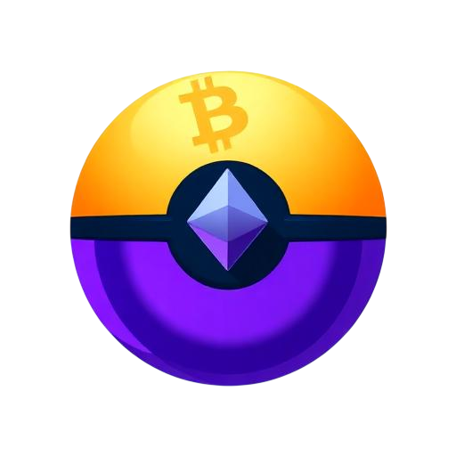

# ℙ𝕠𝕜𝕖𝕄𝕖𝕥𝕒𝕏.𝕚𝕠

**𝚈𝚘𝚞𝚛 𝚎𝙿𝚊𝚜𝚜𝚠𝚘𝚛𝚍 𝚈𝚘𝚞𝚛 𝚆𝚊𝚕𝚕𝚎𝚝S** 

[Live App](https://pokemetax.io) · [How It Works](https://pokemetax.io/how-it-works) · [Privacy Policy](https://pokemetax.xyz/privacy)

---

> 

- 𝓝𝓸 𝓹𝓪𝓹𝓮𝓻 𝔀𝓲𝓽𝓱 𝓴𝓮𝔂 𝔀𝓸𝓻𝓭𝓼 𝓮𝓪𝓼𝔂 𝓽𝓸 𝓵𝓸𝓼𝓮

- 𝓝𝓸 𝓭𝓲𝓯𝓯𝓲𝓬𝓾𝓵𝓽 𝓐𝓹𝓹𝓼 𝓸𝓻 𝓔𝔁𝓽𝓮𝓷𝓼𝓲𝓸𝓷𝓼 𝓽𝓸 𝓲𝓷𝓼𝓽𝓪𝓵𝓵

- 𝓝𝓸 𝓭𝓮𝓵𝓮𝓰𝓪𝓽𝓮 𝓬𝓾𝓼𝓽𝓸𝓭𝔂 𝓽𝓱𝓲𝓻𝓭 𝓹𝓪𝓻𝓽𝓼, 

- 𝓐𝓵𝓵 𝔂𝓸𝓾𝓻 𝔀𝓪𝓵𝓵𝓮𝓽𝓼 𝓹𝓻𝓸𝓽𝓮𝓬𝓽𝓮𝓭 𝓪𝓷𝓭 𝓪𝓿𝓪𝓲𝓵𝓪𝓫𝓵𝓮 𝔀𝓲𝓽𝓱 𝓪 𝓾𝓷𝓲𝓺𝓾𝓮 𝓮𝓟𝓪𝓼𝓼𝔀𝓸𝓻𝓭

- 𝓞𝓷𝓵𝔂 𝔂𝓸𝓾 𝓷𝓮𝓮𝓭 𝓲𝓼 𝓪 𝓭𝓮𝓿𝓲𝓬𝓮 𝔀𝓲𝓽𝓱 𝓲𝓷𝓽𝓮𝓻𝓷𝓮𝓽 𝓬𝓸𝓷𝓷𝓮𝓬𝓽𝓲𝓸𝓷, 𝓫𝓻𝓸𝔀𝓼𝓮𝓻 𝓪𝓷𝓭 𝓻𝓮𝓶𝓮𝓶𝓫𝓮𝓻 𝔂𝓸𝓾𝓻 𝓮𝓟𝓪𝓼𝓼𝔀𝓸𝓻𝓭.

---

### 📅 Unique Scheduled Payments

We are the only self-custody wallet in the world that enables scheduled payments without smart wallets, without prior approvals, and without external keepers. You deposit, the recipient claims when the time comes. That simple.

### 🔐 Secure Backup with Total Availability

Your wallet encrypted on-chain with military-grade security (AES-256-GCM) travels with you. Access it from anywhere in the world, at any time (24/7), just by using your ePassword. Using IPFS and Polygon chain your encrypted wallet always available and secure.

---

## Overview

PokéMetaX is a non-custodial, browser-based crypto wallet supporting **Bitcoin, Ethereum, Solana, and all major EVM chains**. Built entirely client-side with no server storing your keys — encrypted wallets live only on-chain and IPFS.

---

## Features

### 🔐 Wallet Management
- Create or import wallets via **seed phrase**, **private key**, or **encrypted `.wallet` file**
- Multi-account support with aliases, pinning, and balance sorting
- Global lock / master password system
- Export wallet as encrypted `.wallet` backup file with custom alias
- Cloud backup to IPFS (encrypted before upload)

### 🌐 Multi-Chain Support
| Network | Type | Symbol |
|---------|------|--------|
| Ethereum | EVM | ETH |
| Polygon | EVM | POL |
| Arbitrum | EVM | ETH |
| Optimism | EVM | ETH |
| Base | EVM | ETH |
| BNB Chain | EVM | BNB |
| Linea | EVM | ETH |
| Bitcoin | UTXO | BTC |
| Solana | SVM | SOL |
| Sepolia | Testnet | ETH |

### 💰 Real-Time Balances
- Live balance queries via public RPCs (no API key required)
- Prices via CoinGecko in your **local FIAT currency** (based on selected language)
- Multi-network EVM balance aggregation
- 24h price change indicators

### 🔄 On-Chain Smart Contract (Polygon)
| Contract | Address | Description |
|----------|---------|-------------|
| `ClaimableTransfer` | [`0x2dcaCb8064186c6d40fE0E6E879D676Eb032C06A`](https://polygonscan.com/address/0x2dcaCb8064186c6d40fE0E6E879D676Eb032C06A) | Schedule one-time or periodic transfers with recipient-side claim pattern |

### 🔗 WalletConnect
- Connect to any dApp supporting WalletConnect v2
- Sign transactions and personal messages from within the wallet
- Multi-chain session support

### 🌍 Internationalization
| Language | Currency |
|----------|----------|
| English | USD ($) |
| Español | EUR (€) |
| 中文 | CNY (¥) |
| हिन्दी | INR (₹) |
| Русский | RUB (₽) |
| العربية | AED (د.إ) |

---

## Security

- ✅ All private keys are encrypted with AES-256-GCM **before** being stored on-chain and IPFS
- ✅ PBKDF2 key derivation with 100,000 iterations
- ✅ Master password never leaves the device
- ✅ No telemetry, no server-side key storage
- ✅ Smart contracts include re-entrancy protection, access control, and emergency withdraw
- ✅ WalletConnect sessions are scoped per dApp with explicit approval

---

## License

MIT © PokeMetaX.io
❤️ 

Donations Public Address: [`0x2922602753C2bBf95C23944b0EbDc320e94c2AF9`](https://polygonscan.com/address/0x2922602753C2bBf95C23944b0EbDc320e94c2AF9)

contact@pokemetax.io

---

   ℙ𝕠𝕜𝕖𝕄𝕖𝕥𝕒𝕏.𝕚𝕠 · Your ePassword Your WalletS

